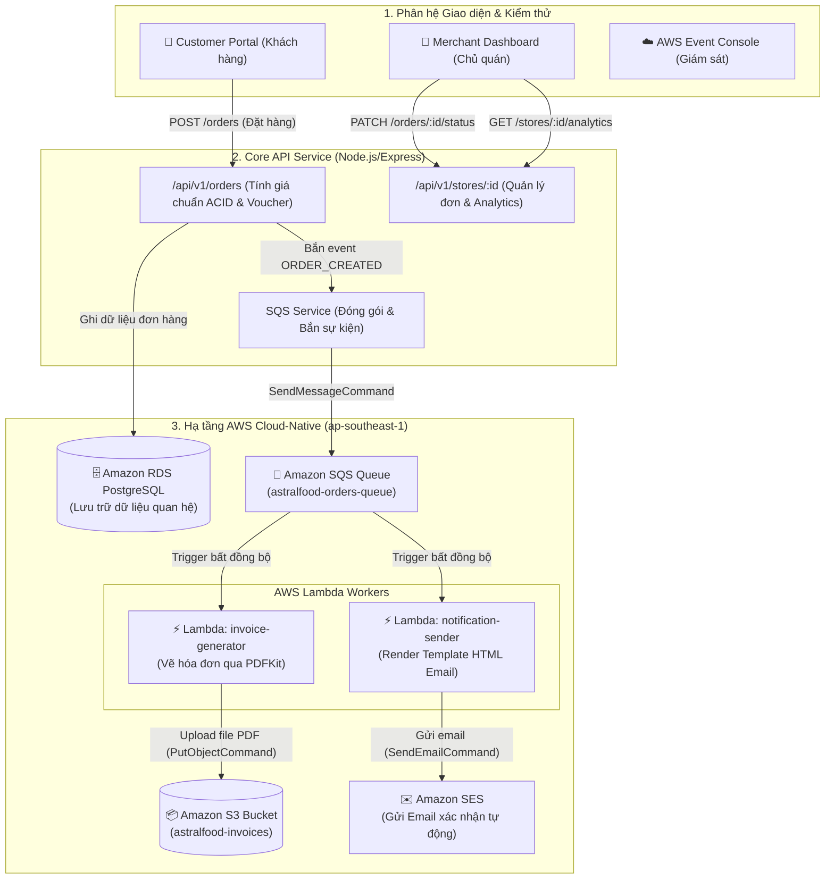

# 📋 BÁO CÁO KỸ THUẬT: KIẾN TRÚC AWS & HƯỚNG DẪN TEST PHÂN HỆ TV2
## DỰ ÁN: ASTRALFOOD — NỀN TẢNG ĐẶT ĐỒ ĂN & THƯƠNG MẠI ĐIỆN TỬ ĐA KÊNH TRÊN AWS

> **Phân hệ**: Order Engine & AWS Event-Driven Serverless (Thành viên 2)  
> **Nhánh Git**: `feat/tv2-orders-serverless`  
> **Region AWS**: Singapore (`ap-southeast-1`)  
> **Trạng thái**: Hoàn thiện Core API, Tích hợp Lambda Workers, Hoàn thiện Live Test UI Portal.

---

## 🌟 1. TỔNG QUAN VAI TRÒ THÀNH VIÊN 2 (TV2)
Trong hệ thống AstralFood, **Thành viên 2** đóng vai trò là **Order Engine & Serverless Lead**, chịu trách nhiệm toàn bộ vòng đời của đơn hàng và phân hệ xử lý bất đồng bộ không máy chủ:
* **Core Order Engine (REST API)**: Tiếp nhận đặt hàng, tính toán đơn giá chuẩn ACID, áp dụng mã voucher, quản lý trạng thái đơn hàng và phân tích doanh thu quán.
* **Hạ tầng AWS Event-Driven Serverless**: Tách rời quy trình xử lý nặng (tạo hóa đơn PDF và gửi email xác nhận) thông qua hàng đợi thông điệp và điện toán không máy chủ.
* **Giao diện Test UI Suite**: Tích hợp cổng kiểm thử tương tác trực quan cho phép kiểm tra toàn diện chức năng của Khách hàng, Chủ quán và Màn hình quan sát AWS.

---

## 🏗️ 2. SƠ ĐỒ KIẾN TRÚC HỆ THỐNG TRÊN AWS



---

## 🛠️ 3. CHI TIẾT CÔNG NGHỆ & CÁC DỊCH VỤ AWS ĐƯỢC ÁP DỤNG

### 3.1. Amazon SQS (Simple Queue Service)
* **Vị trí mã nguồn**: `backend/src/services/sqsService.js`
* **Mục đích**: Áp dụng mô hình **Decoupling (Phân rã hệ thống)**. Thay vì bắt client phải đợi render file PDF (2-3 giây) và gửi email qua Internet (1-2 giây), API chỉ lưu đơn vào DB rồi bắn message JSON vào SQS trong **< 50ms**, phản hồi kết quả tức thì cho khách hàng.
* **Cơ chế Local Fallback**: Tự động nhận diện môi trường dev; nếu chưa điền URL Queue thật của AWS, hệ thống sẽ tự động kích hoạt chế độ **Simulation Log** lưu sự kiện in-memory để kiểm thử an toàn, không tốn chi phí.

### 3.2. AWS Lambda (Worker 1: invoice-generator)
* **Vị trí mã nguồn**: `lambda-workers/invoice-generator/index.js`
* **Mục đích**: Xử lý điện toán không máy chủ (Serverless Compute), tự động co giãn theo số lượng đơn hàng mà không cần duy trì server EC2 tốn kém.
* **Thư viện chính**: `pdfkit`, `@aws-sdk/client-s3`.
* **Cách hoạt động**: Khi nhận trigger từ SQS:
  1. Trích xuất và chuẩn hóa thông tin đơn hàng (`normalizeOrderData`).
  2. Vẽ hóa đơn chuyên nghiệp theo kích thước A4 (Logo AstralFood, thông tin người nhận, bảng chi tiết món ăn, đơn giá, chiết khấu voucher và tổng tiền).
  3. Đẩy buffer PDF trực tiếp lên Amazon S3.

### 3.3. Amazon S3 (Simple Storage Service)
* **Vị trí mã nguồn**: Lệnh `PutObjectCommand` trong `invoice-generator/index.js`.
* **Bucket cấu hình**: `s3://astralfood-invoices/invoices/{order_id}.pdf`.
* **Mục đích**: Lưu trữ bền vững hóa đơn điện tử độc lập với cơ sở dữ liệu quan hệ, giúp database nhẹ và tối ưu tốc độ truy vấn.

### 3.4. AWS Lambda (Worker 2: notification-sender)
* **Vị trí mã nguồn**: `lambda-workers/notification-sender/index.js`
* **Mục đích**: Xử lý gửi thông báo khách hàng bất đồng bộ.
* **Thư viện chính**: `@aws-sdk/client-ses`.
* **Cách hoạt động**:
  1. Nhận sự kiện từ SQS độc lập với Worker 1 (Mô hình Fan-out / Multi-consumer).
  2. Tạo template HTML Email responsive mang phong cách AstralFood (màu chủ đạo `#FF5A1F`).
  3. Gửi lệnh qua Amazon SES.

### 3.5. Amazon SES (Simple Email Service)
* **Vị trí mã nguồn**: Lệnh `SendEmailCommand` trong `notification-sender/index.js`.
* **Mục đích**: Gửi email thông báo đơn hàng thành công trực tiếp đến hòm thư người dùng (`Destination: { ToAddresses: [recipientEmail] }`).

---

## 📡 4. DANH MỤC API CONTRACT (PHÂN HỆ TV2)

| Method | Endpoint | Quyền hạn | Mô tả chi tiết |
| :--- | :--- | :--- | :--- |
| `POST` | `/api/v1/orders` | Customer | Đặt đơn mới: Kiểm tra món ăn, tính tổng tiền chuẩn ACID, tính voucher, lưu đơn, bắn event vào SQS. |
| `GET` | `/api/v1/orders/my-orders` | Customer | Khách hàng lấy danh sách và trạng thái các đơn hàng đã đặt. |
| `GET` | `/api/v1/stores/:id/orders` | Merchant | Chủ quán lấy danh sách đơn hàng đổ về quán (có hỗ trợ lọc theo query `status`). |
| `PATCH` | `/api/v1/orders/:id/status` | Merchant | Chủ quán cập nhật tiến trình đơn: `PENDING` ➔ `PREPARING` ➔ `DELIVERING` ➔ `COMPLETED` / `CANCELLED`. |
| `GET` | `/api/v1/stores/:id/analytics` | Merchant | Thống kê số liệu quán: Tổng doanh thu hoàn tất, tổng số đơn, Top 5 món ăn bán chạy nhất. |
| `GET` | `/api/v1/products` | Public | Lấy danh mục món ăn (hỗ trợ lọc theo `store_id`). |
| `GET` | `/api/v1/sqs/events` | Public / Test | Lấy danh sách các JSON payload sự kiện vừa được gửi vào hàng đợi SQS. |
| `GET` | `/api/v1/orders/:id/invoice-preview` | Public / Test | Kích hoạt Lambda `invoice-generator` để tải/xem trước file PDF hóa đơn trực tiếp trên trình duyệt. |
| `GET` | `/api/v1/orders/:id/email-preview` | Public / Test | Kích hoạt Lambda `notification-sender` để xem trước giao diện Email HTML của AWS SES. |

---

## 💻 5. HƯỚNG DẪN KHỞI CHẠY & TEST BẰNG GIAO DIỆN UI

### 5.1. Khởi động hệ thống
Mở terminal tại thư mục backend và chạy:
```powershell
cd "astral-food\backend"
npm run dev
# Hoặc: node src/server.js
```

### 5.2. Mở giao diện Test Suite
Truy cập trình duyệt tại địa chỉ:
👉 **`http://localhost:5000`**

### 5.3. Kịch bản test thực tế:
1. **Bước 1 (Khách đặt món)**:
   * Tại tab **"Khách Đặt Món"**, chọn quán *Trà Sữa AstralFood* (`store-1`) hoặc *Cơm Tấm Sài Gòn* (`store-2`).
   * Bấm `➕ Thêm vào giỏ` một số món ăn.
   * Nhập mã voucher `ASTRAL20` để xem giảm giá 20% tự động hiển thị.
   * Bấm nút **"🚀 Đặt Đơn Hàng Ngay (Bắn SQS Event)"**.
2. **Bước 2 (Kiểm tra AWS Lambda)**:
   * Ngay tại bảng **Lịch sử đơn hàng**:
     * Bấm nút **`📄 Hóa đơn PDF`**: Trình duyệt sẽ mở modal hiển thị file PDF hóa đơn được vẽ động bởi Lambda Worker.
     * Bấm nút **`✉️ Xem Email`**: Xem trước giao diện email xác nhận mà SES sẽ gửi.
3. **Bước 3 (Chủ quán xử lý & Analytics)**:
   * Chuyển sang tab **"Chủ Quán (Merchant & Analytics)"**.
   * Đơn hàng vừa đặt xuất hiện ở trạng thái `Chờ xác nhận`.
   * Bấm các nút: `👨‍🍳 Nhận nấu` ➔ `🛵 Giao hàng` ➔ `✅ Hoàn tất`.
   * Khi đơn chuyển sang `COMPLETED`, thẻ **Tổng Doanh Thu** và **Đơn Hàng Hoàn Thành** lập tức tự động tăng lên.
4. **Bước 4 (Quan sát sự kiện AWS)**:
   * Chuyển sang tab **"AWS Event-Driven Console"**.
   * Quan sát Message Body JSON vừa được hệ thống đóng gói và đẩy vào hàng đợi SQS.

---

## 🎤 6. CÂU HỎI THƯỜNG GẶP KHI BẢO VỆ ĐỒ ÁN (FAQ)

**Q1: Tại sao không gọi trực tiếp Lambda từ API mà phải thông qua Amazon SQS?**
> *Trả lời*: Đây là nguyên lý **Loose Coupling (Liên kết lỏng)** trong kiến trúc Cloud. Nếu gọi Lambda đồng bộ, khi lượng truy cập tăng vọt hoặc dịch vụ gửi email bị nghẽn mạng, API sẽ bị nghẽn theo (chậm hoặc timeout). Nhờ có SQS làm hàng đợi đệm (buffer), API phản hồi ngay lập tức, các Worker Lambda sẽ tiêu thụ thông điệp theo khả năng chịu tải mà không bao giờ làm sập hệ thống hoặc mất đơn hàng của khách.

**Q2: Việc tính giá tiền đơn hàng được bảo mật như thế nào?**
> *Trả lời*: Backend không bao giờ nhận giá tiền (`price` hoặc `total_amount`) do Frontend gửi lên vì người dùng có thể can thiệp sửa request. Backend chỉ nhận danh sách mã món ăn (`product_id`) và số lượng (`quantity`), sau đó tự truy vấn bảng Catalogue để lấy đơn giá gốc và tính toán tổng tiền chuẩn ACID.

**Q3: Dự án đã tuân thủ quy tắc Free Tier của AWS như thế nào?**
> *Trả lời*: 
> - Amazon SQS miễn phí 1.000.000 requests/tháng.
> - AWS Lambda miễn phí 1.000.000 lượt thực thi và 3.2 triệu giây tính toán/tháng.
> - Hệ thống có sẵn tầng Smart Simulation giúp test toàn bộ tính năng local mà không tiêu tốn tài nguyên thật khi đang phát triển.

---
*Tài liệu được cập nhật tự động đồng bộ theo Git commit `71f1834` trên nhánh `feat/tv2-orders-serverless`.*
