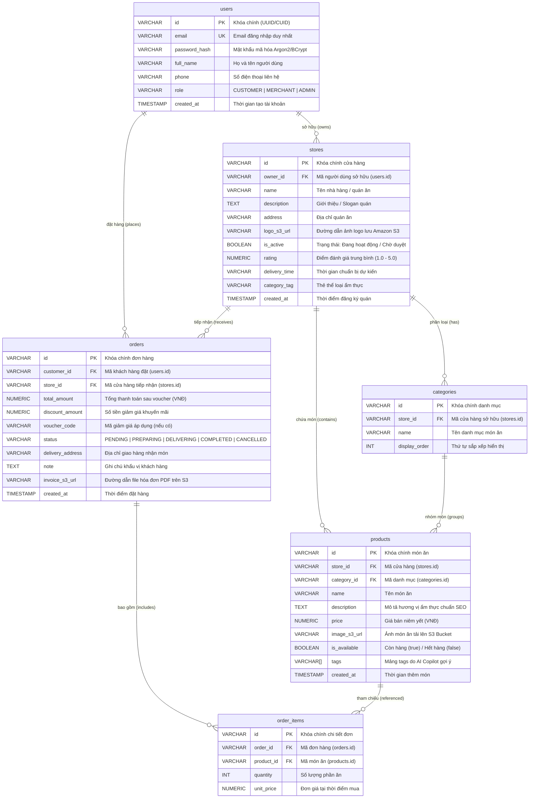
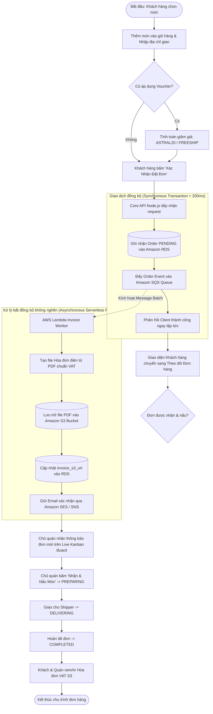
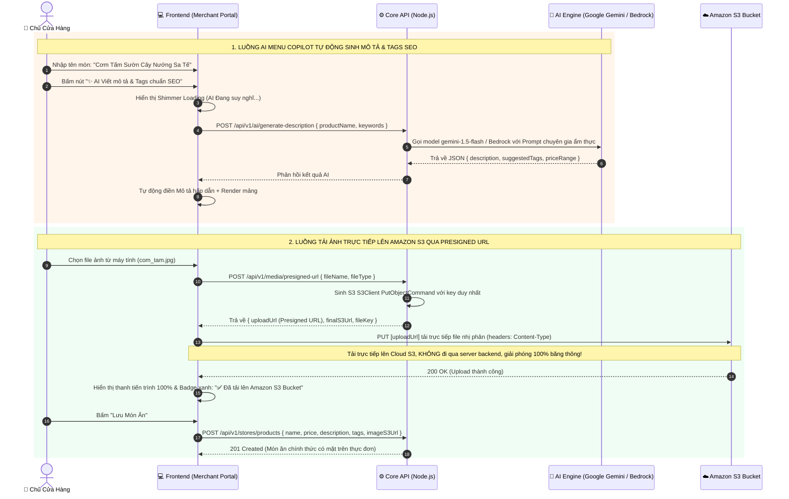
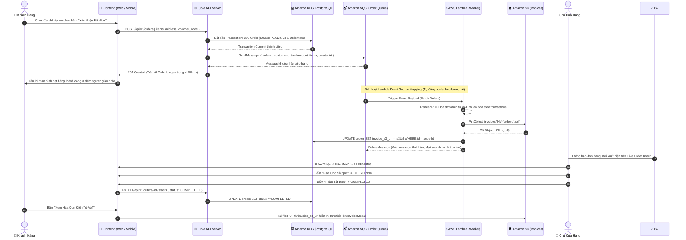
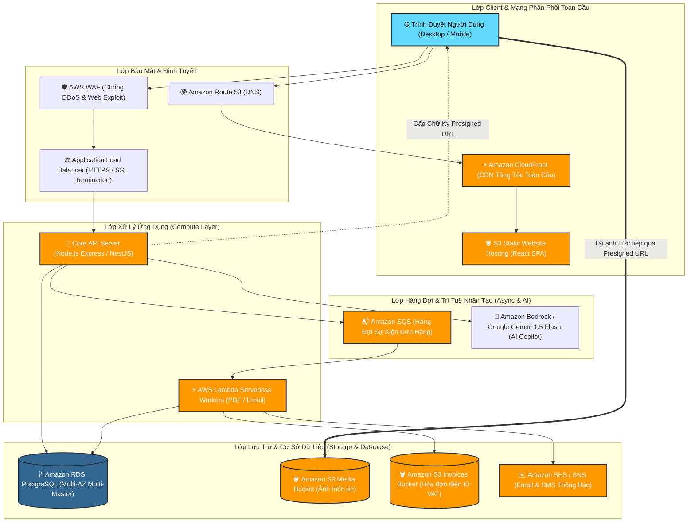

# 📐 BỘ SƠ ĐỒ UML & THIẾT KẾ KIẾN TRÚC HỆ THỐNG ASTRALFOOD
> **Dự án**: Nền Tảng Thương Mại Điện Tử Ẩm Thực Đa Kênh Tích Hợp AI & Hạ Tầng Đám Mây AWS  
> **Tài liệu phục vụ**: Báo cáo Đồ án Chuyên ngành / Khóa luận Tốt nghiệp & Bảo vệ trước Hội đồng

---

## 📌 MỤC LỤC TÀI LIỆU
1. [Sơ đồ Use Case Tổng thể (Use Case Diagram)](#1-sơ-đồ-use-case-tổng-thể-use-case-diagram)
2. [Sơ đồ Thực thể Liên kết (Entity Relationship Diagram - ERD)](#2-sơ-đồ-thực-thể-liên-kết-erd---entity-relationship-diagram)
3. [Sơ đồ Hoạt động Đặt hàng & Xử lý Bất đồng bộ (Activity Diagram)](#3-sơ-đồ-hoạt-động-đặt-hàng--xử-lý-bất-đồng-bộ-activity-diagram)
4. [Sơ đồ Tuần tự 1: Trợ lý AI Menu Copilot & Tải ảnh Amazon S3 Presigned URL (Sequence Diagram)](#4-sơ-đồ-tuần-tự-1-trợ-lý-ai-menu-copilot--tải-ảnh-amazon-s3-presigned-url)
5. [Sơ đồ Tuần tự 2: Luồng Đặt hàng & Xử lý Hóa đơn Điện tử Serverless (Sequence Diagram)](#5-sơ-đồ-tuần-tự-2-luồng-đặt-hàng--xử-lý-hóa-đơn-serverless-sqs--lambda)
6. [Sơ đồ Kiến trúc Hạ tầng Đám mây AWS Tổng thể (AWS Cloud Architecture)](#6-sơ-đồ-kiến-trúc-hạ-tầng-đám-mây-aws-tổng-thể)

---

## 1. Sơ đồ Use Case Tổng thể (Use Case Diagram)
Sơ đồ mô tả tương tác của 3 tác nhân chính trong hệ sinh thái AstralFood: **Khách hàng (Customer)**, **Chủ cửa hàng (Merchant)** và **Quản trị viên hệ thống (System Admin)**.

```mermaid
graph LR
    %% Actors
    Customer(["👤 Khách Hàng (Customer)"])
    Merchant(["🏪 Chủ Quán (Merchant)"])
    Admin(["🛡️ Quản Trị Viên (Admin)"])

    %% Subsystem: Customer Portal
    subgraph "Phân Hệ Khách Hàng (Customer Portal)"
        UC_C1("Đăng ký / Đăng nhập tài khoản")
        UC_C2("Tìm kiếm & Lọc quán theo danh mục")
        UC_C3("Xem thực đơn & Chi tiết món ăn")
        UC_C4("Quản lý giỏ hàng & Áp mã Voucher")
        UC_C5("Thực hiện Đặt hàng (Checkout)")
        UC_C6("Theo dõi tiến trình đơn hàng (Real-time)")
        UC_C7("Tra cứu & In Hóa đơn điện tử VAT S3")
    end

    %% Subsystem: Merchant Hub
    subgraph "Phân Hệ Chủ Quán (Merchant Hub)"
        UC_M1("Đăng ký gian hàng (Chờ duyệt)")
        UC_M2("Quản lý hồ sơ & Bật/tắt mở quán")
        UC_M3("Quản lý danh mục & Thực đơn món ăn")
        UC_M4("Công tắc Còn hàng / Hết hàng 1 chạm")
        UC_M5("AI Menu Copilot sinh mô tả & Tags SEO")
        UC_M6("Upload ảnh món ăn lên Amazon S3 Presigned URL")
        UC_M7("Điều phối đơn hàng trực tiếp (Kanban)")
        UC_M8("Xem biểu đồ doanh thu Recharts (Area/Bar)")
    end

    %% Subsystem: System Admin Portal
    subgraph "Phân Hệ Quản Trị Hệ Thống (Admin Portal)"
        UC_A1("Đăng nhập bảng điều khiển Admin Hub")
        UC_A2("Giám sát GMV & Sức khỏe dịch vụ AWS")
        UC_A3("Thẩm định & Phê duyệt mở quán mới")
        UC_A4("Tạm khóa / Ngưng hoạt động cửa hàng")
        UC_A5("Quản lý tài khoản & Phân quyền User")
        UC_A6("Giám sát & Tra cứu toàn bộ đơn hàng sàn")
    end

    %% Customer Connections
    Customer --- UC_C1
    Customer --- UC_C2
    Customer --- UC_C3
    Customer --- UC_C4
    Customer --- UC_C5
    Customer --- UC_C6
    Customer --- UC_C7

    %% Merchant Connections
    Merchant --- UC_C1
    Merchant --- UC_M1
    Merchant --- UC_M2
    Merchant --- UC_M3
    Merchant --- UC_M4
    Merchant --- UC_M5
    Merchant --- UC_M6
    Merchant --- UC_M7
    Merchant --- UC_M8

    %% Admin Connections
    Admin --- UC_A1
    Admin --- UC_A2
    Admin --- UC_A3
    Admin --- UC_A4
    Admin --- UC_A5
    Admin --- UC_A6
```

---

## 2. Sơ đồ Thực thể Liên kết (ERD - Entity Relationship Diagram)
Cấu trúc cơ sở dữ liệu quan hệ gồm 6 bảng chuẩn hóa lưu trữ trên **Amazon RDS PostgreSQL**:

---

## 3. Sơ đồ Hoạt động Đặt hàng & Xử lý Bất đồng bộ (Activity Diagram)
Mô tả luồng người dùng đặt món và kiến trúc xử lý bất đồng bộ chống nghẽn cổ chai thông qua hàng đợi **Amazon SQS** và **AWS Lambda**:

---

## 4. Sơ đồ Tuần tự 1: Trợ lý AI Menu Copilot & Tải ảnh Amazon S3 Presigned URL
Mô tả hai tính năng điện toán đám mây & AI đột phá trong **Phân hệ Chủ quán (Merchant Hub)**:

---

## 5. Sơ đồ Tuần tự 2: Luồng Đặt hàng & Xử lý Hóa đơn Serverless (SQS + Lambda)
Mô tả quy trình xử lý đơn hàng chịu tải cao (High Throughput & Resilient) kết hợp cơ sở dữ liệu **PostgreSQL ACID** và dịch vụ xử lý ngầm **Serverless**:

---

## 6. Sơ đồ Kiến trúc Hạ tầng Đám mây AWS Tổng thể
Sơ đồ kiến trúc toàn diện phản ánh mô hình triển khai của AstralFood tại khu vực **`ap-southeast-1` (Singapore)**:

---

*Tài liệu được khởi tạo và đồng bộ tự động cho AstralFood Platform - Đề tài Đồ án Chuyên ngành Điện toán Đám mây.*